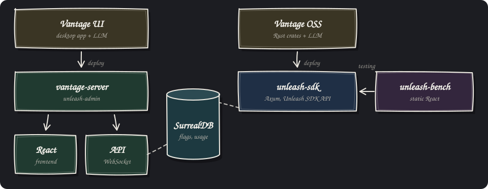

# unleash-vg

A feature-flag service for Unleash SDKs. It keeps Unleash's SDK API (`/api/client` and
`/api/frontend`, with the same tokens, ETags and CORS), so SDKs that poll it work unchanged, and
replaces the admin side with a simpler model built for white-label products: flags × environments
× brands, each flag on, off or a percentage, with customer allowlists and per-brand overrides.
Variants, other constraint types, streaming and Unleash's Admin API are left out on purpose; the
full list is in [`docs/spec/01-scope.md`](docs/spec/01-scope.md), and
[`docs/spec/09-acceptance.md`](docs/spec/09-acceptance.md) is how compatibility is checked.

It was built by Claude Opus 5.5 with [Vantage](https://vantage-ui.com) and is shared under the MIT
licence, for anyone who needs a free alternative to Unleash or a similar service.

[](https://unleash-vg-admin-129027965449.europe-west2.run.app/)
[](https://unleash-vg-sdk-129027965449.europe-west2.run.app/health)
[](https://unleash-vg-bench-129027965449.europe-west2.run.app/)

The demo runs on sample data. Sign in to the admin as any user listed on its sign-in page
(password `demo`), change a flag, and watch the bench's mock bank follow it. Everyone shares the
same demo, so expect other people's changes. Each service sleeps when idle, so the first request
after a quiet spell takes a few seconds.

## The Vantage Desktop App

This version of Unleash is built in Vantage UI with low code: YAML, plus small Rhai snippets.
Vantage UI is free and runs on a Mac, so use it to add the features you need to your own copy. In
production it runs on `vantage-server`, Vantage's cloud-native server. Not sure how something
works? Ask the LLM inside Vantage UI.

Open your clone of this repository in Vantage UI on a Mac. The desktop app is the admin, and it
also builds the web admin (`web/flags/`) in a Docker container and serves it; the web admin talks
to the desktop app over a WebSocket.

Every flag with its state in each environment, brand overrides and when apps last asked for it:


A flag's page: the rule per environment, brand overrides, the share of evaluations served ON, and
its history:


API tokens per environment, created here or imported from an existing Unleash:


## How it fits together



- **The admin** (`unleash-admin`) is a Vantage project: tables, pages and rules in YAML. In
  production it runs on `vantage-server`, the same server Vantage UI runs locally, which serves
  the web admin and the WebSocket API it talks to.
- **The SDK API** (`unleash-sdk`, in `service/`) is a Rust service on the Vantage crates, written
  with an LLM. It reads SurrealDB through them and is what your apps' SDKs call.
- **The bench** (`unleash-bench`, in `testbench/`) is for testing: a static React app served by a
  small Node server, with a mock bank whose screens follow the flags and a stress test. It reads
  flags through the SDK API, like your apps would.

## Running it locally

You need [Vantage UI](https://vantage-ui.com) 1.9 or later (free) and Docker. Vantage UI needs
nothing else: it builds and runs everything in containers. The setup scripts in step 3 use `curl`
and `python3`; a Mac without `python3` offers to install Apple's command-line tools, which have it.

1. Create `.env` from `.env.example`, with a token of your own:

   ```
   sed "s/^SECRET_INTERNAL_TOKEN=.*/SECRET_INTERNAL_TOKEN=$(openssl rand -hex 32)/" .env.example > .env
   ```

2. Open this folder in Vantage UI. It starts SurrealDB and the SDK API from `composer.yaml`; the
   first start builds the SDK API's image and takes a few minutes. The Services panel shows when
   both are running.
3. Load the schema and the sample data, in this order, then the sign-in list and the six local SDK
   tokens (`docs/spec/reference-data/default-tokens.json`, the bench's example config uses them):

   ```
   for f in schema seed events; do tests/surql.sh tests/$f.surql -q; done
   tests/sync_web_users.sh
   tests/import_default_tokens.sh
   ```

   The scripts find the stack by the folder's name; with a clone under another name, set
   `COMPOSE_PROJECT` to the name the Services panel shows. To start again from scratch:
   `echo 'REMOVE DATABASE flags;' | tests/surql.sh -`, then run step 3 again.
4. In Vantage UI, open the Services panel and start the `flags` web admin. It opens in your
   browser.
5. Sign in as any demo user with the password `demo`, for example `admin@example.com`.

The SDK API listens on `http://127.0.0.1:4380` (`curl http://127.0.0.1:4380/health` answers
`{"health":"GOOD"}`).

To try it from the SDK side, start the bench, which runs on your machine and needs Node 24 or
later. Its config needs the SurrealDB port the stack published (`docker compose ls`, then
`docker compose -p <project> -f composer.yaml port surrealdb 8000`); the `unleash` target in the
example config is optional, for comparing against a real Unleash:

```
cd testbench
npm install
cp testbench.config.example.json testbench.config.json   # set the SurrealDB port
npm start                                                 # http://localhost:4300
```

The mock bank follows a flag change within a few seconds. The local bench also reads the brand
list from SurrealDB; the hosted bench has it in its config.

## Fork and Tweak

unleash-vg is simple on purpose. It does the flag model in `docs/spec/` and stops there, so the
whole app stays small enough to read in an afternoon. Need a feature it doesn't have? Ask the
built-in agent to add it: rename the brands, add a field to flags, or swap the rollout rules for
your own.

1. Set it up as in [Running it locally](#running-it-locally).
2. Open the agent panel in Vantage UI (the title-bar button, or Cmd-Shift-A) and ask for the
   change, for example "add an owner field to flags". The first open downloads what the agent
   needs, and a sign-in runs inside the panel. It edits the YAML while the admin reloads in front
   of you; the web admin's pages are plain React in `web/flags/`.
3. Deploy it, as in [Deploying your own](#deploying-your-own).

## Deploying your own

Three images, each its own Dockerfile: the admin (`Dockerfile`), the SDK API
(`service/Dockerfile`) and the bench (`testbench/Dockerfile`). No image holds a secret.

- **The SDK API** reads `SURREAL_URL`, `SURREAL_USER`, `SURREAL_PASS` and `SURREAL_AUTH` (the user
  and password default to `root`, so set them), and `INTERNAL_TOKEN`, the bearer token the admin
  reads compiled flags with. Create SDK tokens in the admin's API tokens page, or with
  `flag-service create-token <name> <backend|frontend> <environment>`; never import the six local
  tokens into a hosted database.
- **The admin** reads the `prod` profile (`application.yaml`) from the environment, and its sign-in
  tokens file is mounted at `/app/project/private/web-tokens.yaml`. The Vantage deploy skill (in
  `.agents/skills/vantage-deploy/`, which Vantage UI installs) shows how to package it for any
  container host.

Our own pipeline is a worked example for Google Cloud Run:

- `.github/workflows/checks.yaml` runs on every pull request. It starts the whole stack (SurrealDB,
  the SDK API and the admin under the `ci` profile) and runs the database rules and the web probes
  against it. Its `summary` job must pass before anything merges to `main`.
- `deploy-admin.yaml`, `deploy-sdk.yaml` and `deploy-bench.yaml` deploy on a merge to `main` that
  changes their files. Each service scales to zero and never runs more than a single instance.
- `terraform/` is the cloud side: a deployer that only a protected `main` can use, which can push
  images and deploy new revisions of these three services and nothing else; a runtime account that
  can read only unleash-vg's secrets; the secrets themselves; and the three public services.

## Why SurrealDB

Data lives in [SurrealDB](https://surrealdb.com) because of its live queries. Vantage subscribes
to them (`LIVE SELECT`), so a change someone makes appears straight away for everyone else, in
the desktop app and in the web admin, without anyone reloading.

Vantage itself is database-agnostic. It ships datasources for SQL databases and MongoDB as well, so
the admin's tables, pages and API stay the same on another database: point `datasource/flags.yaml`
at it and adjust the tables' storage settings. Moving off SurrealDB also means rewriting the parts
written in SurrealQL: the database rules in `tests/schema.surql` and `tests/events.surql` (the
append-only audit log, the atomic flag card save, the revision stamps), and the SDK API's queries
in `service/src`.

## How big it is

Non-blank lines of code in each repository's tracked files on 2026-10-27, with tests counted apart
and generated code left out (Unleash's `frontend/src/openapi`, our `vantage.gen.ts`):

| | [Unleash](https://github.com/Unleash/unleash) (LoC) | unleash-vg (LoC) |
|---|---:|---:|
| Admin web app | 192,872 [React](https://react.dev) | 2,324 [React](https://react.dev) |
| Admin backend: API, data model, rules | 103,676 [Express](https://expressjs.com) | 2,481 [Vantage](https://vantage-ui.com) |
| SDK API | (in the backend) | 1,247 [Axum](https://github.com/tokio-rs/axum) |
| **Total** | **296,548** | **6,052** |
| Tests | 122,798 | 1,691 |

That's 49 times less code to read, review and keep running. Most of the difference is Vantage:
tables, pages, access rules and the audit log are YAML it runs, so there's no API layer, ORM or
form code to write. Unleash also does more (projects, segments, change requests, SSO). The bench
(3,124 LoC) has no counterpart in Unleash and isn't counted.

## Licence

MIT. See [LICENSE](LICENSE).
