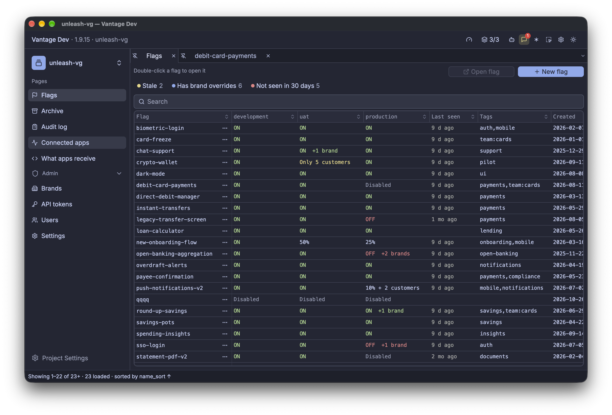
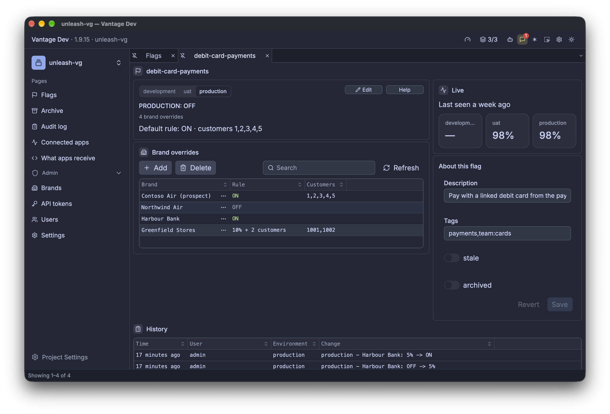
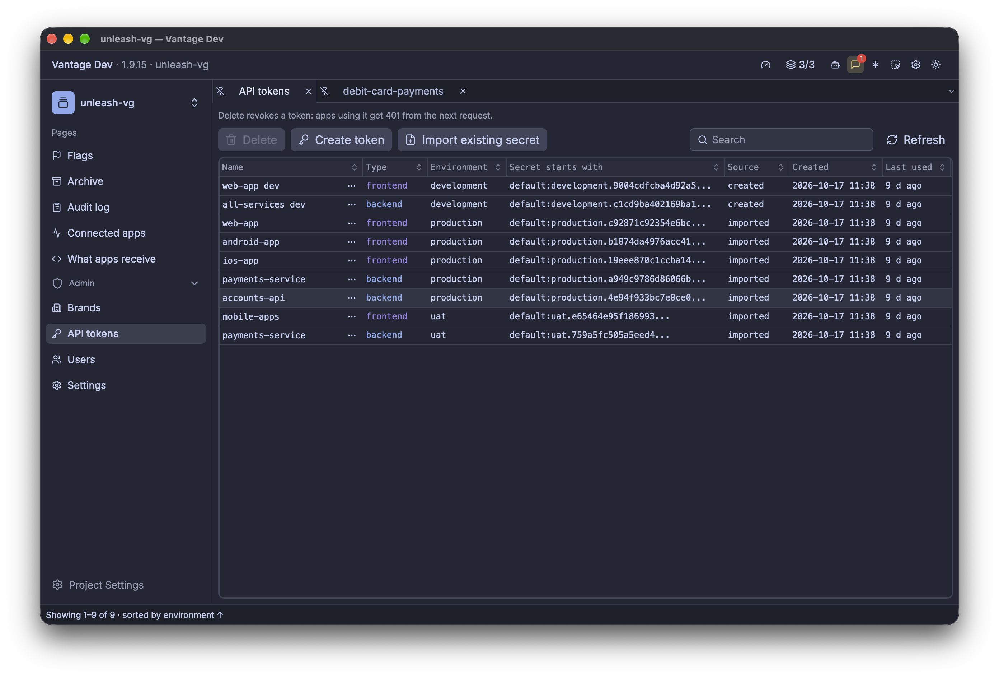

# unleash-vg

A feature-flag service your Unleash SDKs can talk to without code changes. It keeps Unleash's SDK
API (`/api/client` and `/api/frontend`, with the same tokens, ETags and CORS), and replaces the admin
side with a simpler model built for white-label products: flags × environments × brands, each flag
on, off or a percentage, with customer allowlists and per-brand overrides.

It was built by Claude Opus 5.5 with [Vantage](https://vantage-ui.com) and is shared under the MIT
licence, for anyone who needs a free alternative to Unleash or a similar service.

## The admin app

Every flag with its state in each environment, brand overrides and when apps last asked for it:



One flag: the rule per environment, brand overrides, the share of evaluations served ON, and its
history:



API tokens per environment, created here or imported from an existing Unleash:



## What's in the repository

| Folder | What it is |
|---|---|
| root (`table/`, `page/`, `api/`, …) | The admin app, a Vantage project. `api/flags.yaml` is the API the web app uses. |
| `web/flags/` | The admin web app (React and Vite). |
| `service/` | The SDK API, in Rust: what Unleash SDKs connect to. |
| `testbench/` | A mock bank app that runs on the flags, and a stress test. Point it at unleash-vg and at Unleash, side by side. |
| `tests/` | The SurrealDB schema, rules and demo data, plus test scripts. |
| `docs/spec/` | The specification the service is built to. |
| `agents/` | The brief, and the tasks still open. |

Data lives in SurrealDB.

## Running it locally

You need Docker, Node 22 or later, and [Vantage](https://vantage-ui.com) (nightly).

1. Create `.env` with the token the admin app reads compiled flags from the SDK API with:

   ```
   echo "SECRET_INTERNAL_TOKEN=$(openssl rand -hex 32)" > .env
   ```

2. Open this folder in Vantage. It starts SurrealDB and the SDK API from `composer.yaml`.
3. Load the schema and the demo data, in this order:

   ```
   for f in schema seed events; do tests/surql.sh tests/$f.surql; done
   tests/sync_web_users.sh
   ```

4. In Vantage, open Services and start the `flags` web app. It opens in your browser.
5. Sign in as any demo user with the password `demo`, for example `admin@example.com`.

The SDK API listens on `http://127.0.0.1:4380`. In local development it accepts six fixed tokens,
listed in `docs/spec/reference-data/default-tokens.json`.

To try it from the SDK side, start the bench:

```
cd testbench
npm install
cp testbench.config.example.json testbench.config.json   # set the SurrealDB port, add your Unleash
npm start                                                 # http://localhost:4300
```

Change a flag in the admin app and watch the mock bank follow it within a few seconds.

## Deploying your own

The SDK API builds from `service/Dockerfile` and finds its SurrealDB through `SURREAL_URL`,
`SURREAL_USER` and `SURREAL_PASS`. The admin runs on vantage-server with the project and the built
web app; the Vantage deploy skill shows how to package it for any container host, Google Cloud Run
included. Images for the admin and the bench, and our own deployment pipeline as a worked example,
are next (see `agents/TASKS.md`).

Opening the folder in Vantage is also how you change the app: tables, pages and rules are YAML
files, and Vantage's agent can edit them with you.

## Licence

MIT. See [LICENSE](LICENSE).
